## About Me

I’m a **Computer Science student at FAST-NUCES Islamabad** focused on becoming a versatile software engineer working across **AI, full-stack development, and automation**. I enjoy building practical applications and learning how to take them from implementation through testing and deployment.

- Building with **Python, TypeScript, Angular, and React**
- Interested in **AI agents, LLM applications, and workflow automation**
- Developing experience with **backend systems, MLOps, cloud, and DevOps**
- Based in **Islamabad, Pakistan**

## Technologies

**Languages**  

**Frontend**  

**Backend & Databases**  

**Cloud & Developer Tools**  

**Data & ML**  

**AI, Automation & MLOps**  

## Software Engineering Experience

Contributed to an **Angular SaaS application**, building reusable shared UI components and improving member and user management interfaces. Worked on responsive UI, integrated existing backend APIs, and collaborated through team Git workflows and pull requests.

## Currently Exploring

Agentic AI and production-ready LLM applications · LangChain and LangGraph · MCP integrations · Advanced n8n workflows · RAG and document intelligence · Docker, CI/CD, cloud deployment, and DevSecOps

## GitHub Activity

&nbsp;

  

